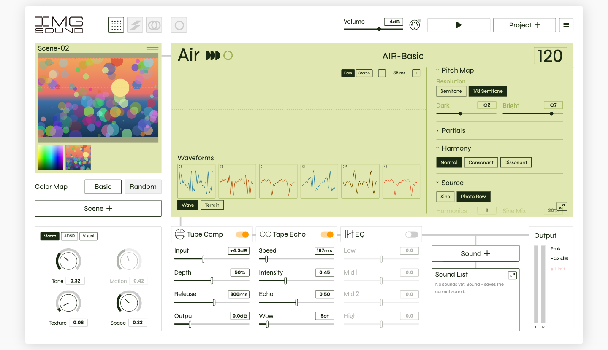
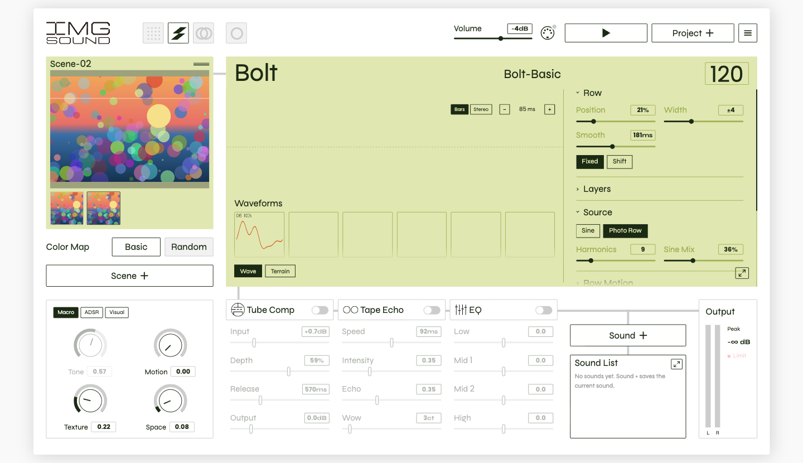
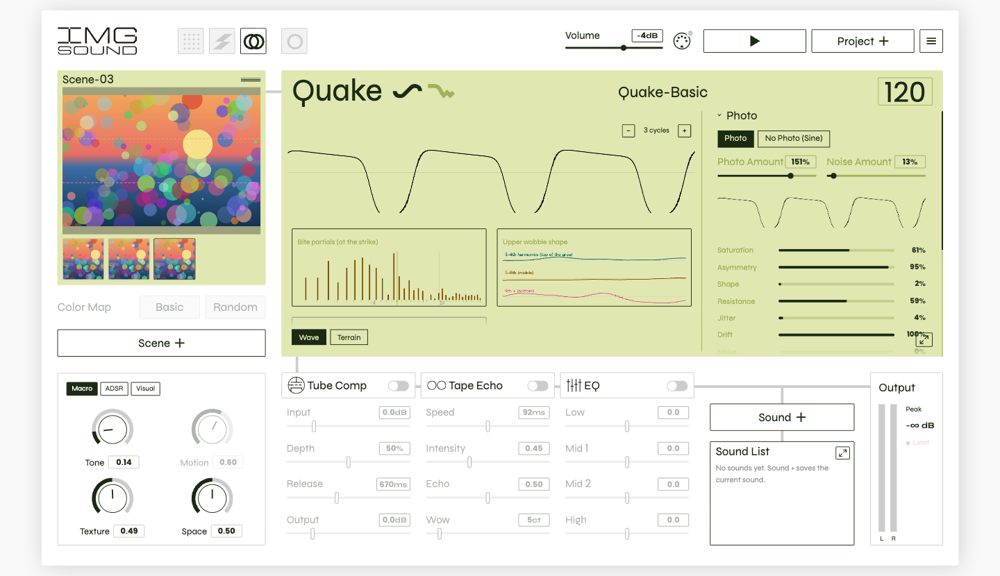
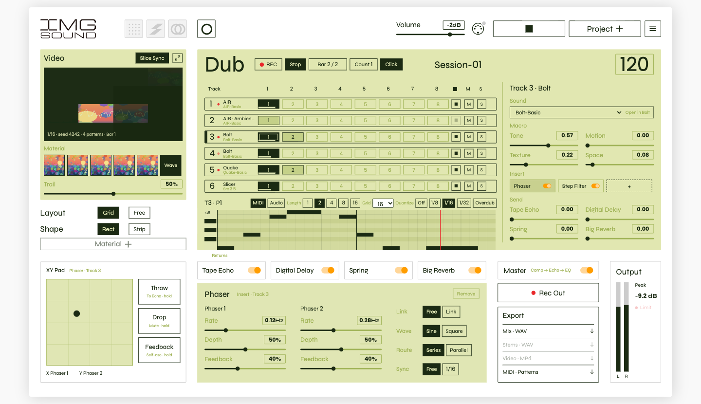

# IMG SOUND

[日本語](README.md) | [English](README.en.md)

A synthesizer in your browser that turns photos into sound.
The colours of a photo become pitches, its brightness the register, and its patterns become waveforms and movement. There are three sound modes, and a Dub mode where you build and record phrases.

- Nothing to install. Just open it in your browser.
- Your photos, recordings and settings stay in your browser (nothing is sent anywhere).
- Free. Change and share it freely for noncommercial use. **You may use the sounds and music you make commercially** ([Commercial Use](COMMERCIAL.md)).

> [!CAUTION]
> ### Before you publish, distribute or sell a work or a Project file made with photos, make sure you have permission from the rights holders of those photos.
>
> See the [Terms of Use (TERMS.md)](TERMS.md).

---

## Contents
1. [Requirements](#1-requirements)
2. [Opening the app](#2-opening-the-app)
3. [The four modes](#3-the-four-modes)
4. [Common controls](#4-common-controls)
5. [Saving and exporting](#5-saving-and-exporting)
6. [Keyboard shortcuts](#6-keyboard-shortcuts)
7. [Troubleshooting](#7-troubleshooting)
8. [License](#8-license)
9. [Contact](#9-contact)

---

## 1. Requirements

| | |
|---|---|
| OS | Windows / macOS (computers only; phones and tablets are not supported) |
| Browser | **Google Chrome** or **Microsoft Edge** (latest version) |
| Screen | 1440 × 830 or larger recommended (smaller screens are scaled down) |
| Keys | Your computer keyboard, or a MIDI keyboard (optional) |

- Some features may not work in Safari or Firefox.
- Photos: JPEG / PNG / WebP / GIF, and HEIC from iPhones.

## 2. Opening the app

**Easiest**: open the public page in Chrome or Edge.
**https://ixixix-btbc.github.io/img-sound/**

**Running it on your own computer** (if you want to change the code)
1. Download this repository (Code → Download ZIP) and unzip it.
2. In the unzipped folder, run one of these:
   - With Python: `python3 -m http.server 8997`
   - With Node.js: `npx serve -l 8997`
3. Open `http://localhost:8997` in Chrome.

Note: double-clicking `index.html` does not work (browsers require the app to be served).
Note: saved data belongs to the address (URL and port). Always open the app at the same address.

## 3. The four modes

Switch modes with the icons at the top left. Everything stays in one page, so Dub keeps playing (even while recording) while you use the other modes.

### AIR (ambient)

Counts the colours in a photo and turns them into a chord-like, sustained sound. Drag on the photo to choose the area that is read.
- Each key press reads a slightly shifted area, so every note is a little different.
- Save areas you like with **Scene +**, and make a long loop that travels through the scenes (30 seconds to 10 minutes).
- In the settings on the right you can change how pitches are mapped, the harmonics, the harmony (consonant / dissonant), movement, noise, stereo width and more.

### Bolt (lead)

Reads rows of the photo as waveforms and plays them as a monophonic lead, with unison voices, a filter and glide.

### Quake (bass)

A sine-wave bass with harmonics and a wobble read from the photo. Move the wobble by hand with the XY pad.

### Dub (phrases)

A sequencer with 6 tracks × 8 patterns.
- Tracks 1–5 play the AIR / Bolt / Quake sounds. Each pattern is either **MIDI** (notes you enter or record) or **Audio** (the sound itself, recorded).
- Track 2 records the AIR loop. Recordings are stretched or squeezed to the pattern length without changing their pitch (Fit). Drag on the waveform to choose the part that is used.
- Track 6 is a slicer: it cuts the patterns of the tracks you choose into pieces and plays them rearranged.
- **Grid** sets how a bar is divided (16 / 12 / 24 / 20 / 10 / 7 / 5), so tracks can play different rhythms against each other (polyrhythm).
- Per-track effects (Phaser and more), four returns (tape echo, digital delay, spring, reverb), an XY pad, and a video view (Slice Sync).
- The ■ in the grid stops a track (and deselects its pattern).

## 4. Common controls

- **Add photos**: drop photos onto the photo area on the left (several at once is fine).
- **Sound +**: save the current sound under a name, and load it again from the Sound List. Each mode starts with its "…-Basic" sound.
- **Finishing** (bottom): tube compressor, tape echo and EQ. A high tape echo Intensity makes it self-oscillate (mind the volume).
- **Volume** and the Output meter at the bottom right. A limiter at the output prevents clipping.
- **MIDI**: click the MIDI icon at the top right to play from a MIDI keyboard.

## 5. Saving and exporting

- **Autosave**: settings, patterns, photos and recordings are saved in your browser automatically.
- **Project +**: **Save Project** writes everything (each mode's sound, your saved Sounds, the tempo, Dub's patterns and recordings, and the photos) into one .zip file. **Open Project…** replaces everything with the contents of a Project. Use it to move your work to another computer or browser, too.
- **Rec Out → Export Mix · WAV**: export what Dub played as a WAV file.
- **MIDI · Patterns**: export Dub's note patterns as a MIDI file.

## 6. Keyboard shortcuts

| Key | Action |
|---|---|
| A W S E D F T G Y H U J K O L P ; | Keys (white: A S D F G H J K L ;, black: W E T Y U O P) |
| Z / X | One octave down / up |
| Esc | Stop everything |
| Space (Dub) | Play / stop |
| 1–8 (Dub) | Switch the selected track's pattern |
| ↑ / ↓ (Dub) | Select a track |
| ⌘Z / Ctrl+Z (Dub) | Undo |
| ⌘C / ⌘V (Dub) | Copy / paste a pattern |
| Delete (Dub) | Clear a pattern |

## 7. Troubleshooting

- **No sound**: click anywhere on the page first, then press a key (browsers do not allow sound before your first action). Check Volume and your computer's volume too.
- **Sound breaks up**: close other tabs and apps. Many tracks in Dub use more processing power.
- **My data is gone**: clearing your browser data removes what the app saved. Keep important work with Save Project.
- **A HEIC photo does not load**: reload the page and try again.

## 8. License

- Source code: **PolyForm Noncommercial License 1.0.0** with an additional permission from the authors ([LICENSE](LICENSE))
  - Use it, change it and share it for free, for noncommercial purposes.
  - **You may use the sounds, music and video you make with the app commercially.**
  - To sell or provide the app itself for a fee, contact us first ([COMMERCIAL.md](COMMERCIAL.md)).
- For the logo, the fonts and the HEIC decoder, see [NOTICE.md](NOTICE.md).
- Terms of Use: [TERMS.md](TERMS.md)

Copyright (c) 2026 IXIXIX from BTBC & HIDEYA KUMAGAI

## 9. Contact

- Commercial use: **ojicrew.web@gmail.com**
- Bug reports and requests: [GitHub Issues](https://github.com/IXIXIX-BTBC/img-sound/issues) (replies are not guaranteed)
- Instagram: [@ojicrew.from.oldcapital](https://www.instagram.com/ojicrew.from.oldcapital/)
