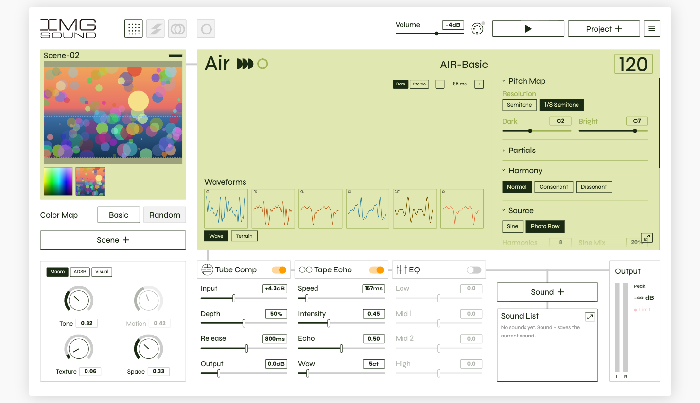
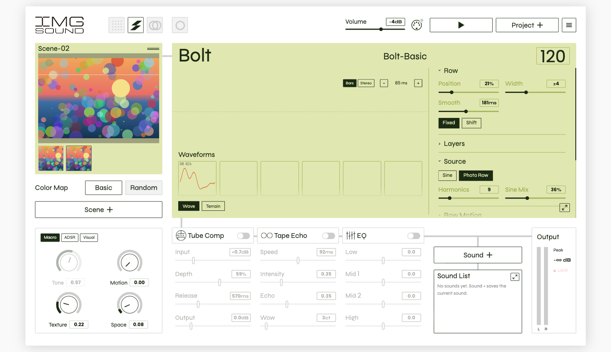
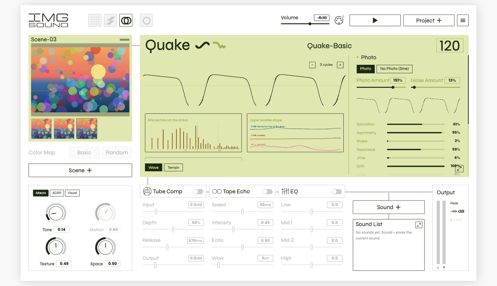
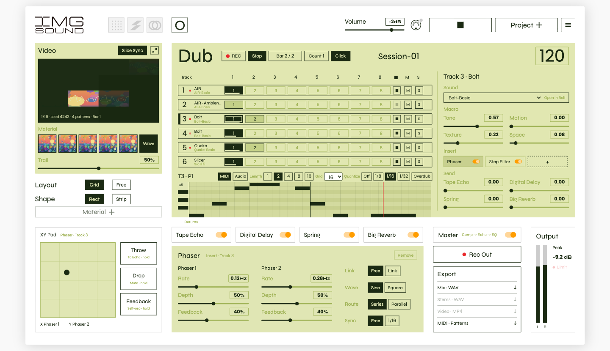

# IMG SOUND

[日本語](README.md) | [English](README.en.md)

写真を読み取って音にする、ブラウザで動くシンセサイザーです。
写真の色を音の高さに、明るさを音域に、写真の模様を波形や揺らぎにして鳴らします。3つの音色モードと、フレーズを組んで録音できる Dub モードがあります。

- インストール不要。ブラウザで開くだけ
- 写真・録った音・設定はすべて、あなたのブラウザの中にだけ保存されます(外部には送りません)
- 無料。非営利なら改造・再配布も自由。**作った音・曲は商用でも使えます**([商用利用について](COMMERCIAL.md))

> [!CAUTION]
> ### 写真を使った作品・Project ファイルを公開・配布・販売するときは、その写真の権利者の許可があることを確かめてください。
>
> 詳しくは [利用上の注意(TERMS.md)](TERMS.md)。

---

## 目次
1. [動作環境](#1-動作環境)
2. [開き方](#2-開き方)
3. [4つのモード](#3-4つのモード)
4. [共通の操作](#4-共通の操作)
5. [保存・書き出し](#5-保存書き出し)
6. [キー操作の一覧](#6-キー操作の一覧)
7. [困ったとき](#7-困ったとき)
8. [ライセンス](#8-ライセンス)
9. [連絡先](#9-連絡先)

---

## 1. 動作環境

| | 対応 |
|---|---|
| OS | Windows / macOS(パソコン。スマートフォン・タブレットは非対応) |
| ブラウザ | **Google Chrome** または **Microsoft Edge**(最新版) |
| 画面 | 1440 × 830 以上を推奨(小さい画面では縮小して表示) |
| 鍵盤 | パソコンのキーボード、または MIDI 鍵盤(任意) |

- Safari・Firefox では、一部の機能が動かないことがあります。
- 写真は JPEG / PNG / WebP / GIF と、iPhone の HEIC が使えます。

## 2. 開き方

**いちばん簡単**:公開ページを Chrome / Edge で開くだけです。
**https://ixixix-btbc.github.io/img-sound/**

**自分の PC で動かす場合**(コードを改造したい人向け)
1. このリポジトリをダウンロード(Code → Download ZIP)して展開します。
2. 展開したフォルダで、次のどちらかを実行します。
   - Python がある場合:`python3 -m http.server 8997`
   - Node.js がある場合:`npx serve -l 8997`
3. Chrome で `http://localhost:8997` を開きます。

※ `index.html` をダブルクリックして開いても動きません(ブラウザの決まりで、サーバー経由で開く必要があります)。
※ 保存データはアドレス(URL とポート番号)ごとに別です。いつも同じアドレスで開いてください。

## 3. 4つのモード

画面の左上のアイコンで切り替えます。1つの画面の中で切り替わるので、Dub で鳴らしたまま(録音中でも)ほかのモードを触れます。

### AIR(アンビエント)

写真の色を数えて、和音のような持続音を作ります。写真の上をドラッグすると、読み取る範囲を選べます。
- 鍵盤を押すたびに、範囲を少しずらした音が鳴ります(毎回少し違う音)。
- 気に入った範囲を **Scene +** で保存し、Loop でシーンをたどる長いループ(30 秒〜10 分)を作れます。
- 右の設定で、音の並べ方・倍音・響き(和音より / 不協和音より)・揺らぎ・ノイズ・左右の広がりなどを変えられます。

### Bolt(リード)

写真の横の列を波形として読み、単音のリード音にします。重ねる声の数、フィルター、グライドなどで、鋭いシンセリードを作れます。

### Quake(ベース)

サイン波の低音に、写真から読んだ倍音と揺れ(ワブル)を足すベースです。XY パッドで揺れを手で動かせます。

### Dub(フレーズ)

6 トラック × 8 パターンのシーケンサーです。
- トラック 1〜5 は AIR / Bolt / Quake の音で鳴ります。パターンごとに **MIDI**(音符で打ち込む・録る)と **Audio**(音そのものを録る)を選べます。
- トラック 2 は AIR のループを録音します。録った音は、パターンの長さに合わせて音の高さを保ったまま伸び縮みします(Fit)。波形の上をドラッグすると、使う範囲を選べます。
- トラック 6 はスライサーです。選んだトラックのパターンを細かく切って、並べ替えて鳴らします。
- **Grid** で 1 小節の分け方(16 / 12 / 24 / 20 / 10 / 7 / 5)を変えられるので、トラックごとに違うリズム(ポリリズム)を重ねられます。
- 各トラックのエフェクト(Phaser など)、4 つのリターン(テープエコー・デジタルディレイ・スプリング・リバーブ)、XY パッド、映像(Slice Sync)があります。
- グリッドの ■ でトラックを止めます(パターンの選択も外れます)。

## 4. 共通の操作

- **写真を入れる**:左の写真の欄に、写真をドラッグ&ドロップします(複数可)。
- **Sound +**:今の音色に名前を付けて保存します。Sound List から読み込めます。最初の音は各モードの「〜-Basic」です。
- **仕上げ**(画面下):真空管コンプ・テープエコー・EQ。テープエコーの Intensity を上げすぎると発振します(音量に注意)。
- **Volume** と右下の Output で、全体の音量を見ながら調整できます。出口には音割れを防ぐリミッターが入っています。
- **MIDI**:右上の MIDI アイコンを押すと、MIDI 鍵盤から弾けます。

## 5. 保存・書き出し

- **自動保存**:設定・パターン・写真・録った音は、ブラウザの中に自動で保存されます。
- **Project +**:**Save Project** で、全部(各モードの音色、保存した Sound、テンポ、Dub のパターンと録った音、写真)を 1 つの .zip に書き出します。**Open Project…** で読み込むと、今の内容がすべてその Project に置き換わります。別の PC やブラウザに移すときにも使います。
- **Rec Out → Export Mix · WAV**:Dub で鳴った音を WAV で書き出します。
- **MIDI · Patterns**:Dub の音符のあるパターンを MIDI ファイルで書き出します。

## 6. キー操作の一覧

| キー | 動作 |
|---|---|
| A W S E D F T G Y H U J K O L P ; | 鍵盤(白鍵 A S D F G H J K L ;、黒鍵 W E T Y U O P) |
| Z / X | 1 オクターブ下 / 上 |
| Esc | 全部止める |
| Space(Dub) | 再生 / 停止 |
| 1〜8(Dub) | 選んでいるトラックのパターンを切り替え |
| ↑ / ↓(Dub) | トラックを選ぶ |
| ⌘Z / Ctrl+Z(Dub) | 元に戻す |
| ⌘C / ⌘V(Dub) | パターンのコピー / 貼り付け |
| Delete(Dub) | パターンを空にする |

## 7. 困ったとき

- **音が出ない**:一度、画面のどこかをクリックしてから鍵盤を押してください(ブラウザの決まりで、最初の操作までは音が出せません)。Volume と、パソコンの音量も確かめてください。
- **音が途切れる**:ほかのタブやアプリを閉じてみてください。Dub で多くのトラックを鳴らすと重くなります。
- **データが消えた**:ブラウザのデータを消すと、保存した内容も消えます。大切なものは Save Project で書き出しておいてください。
- **HEIC の写真が読めない**:一度ページを開き直してから、もう一度入れてみてください。

## 8. ライセンス

- ソースコード:**PolyForm Noncommercial License 1.0.0** + 作者からの追加の許可([LICENSE](LICENSE))
  - 非営利なら、使う・改造する・無料で再配布するのは自由です。
  - **このアプリで作った音・曲・映像は、商用でも自由に使えます。**
  - アプリそのものを有料で販売・提供する場合は、事前にご連絡ください([COMMERCIAL.md](COMMERCIAL.md))。
- ロゴ・フォント・HEIC の読み込み部品の扱いは [NOTICE.md](NOTICE.md) をご覧ください。
- 利用上の注意:[TERMS.md](TERMS.md)

Copyright (c) 2026 IXIXIX from BTBC & HIDEYA KUMAGAI

## 9. 連絡先

- 商用利用の相談:**ojicrew.web@gmail.com**
- 不具合の報告・要望:[GitHub の Issues](https://github.com/IXIXIX-BTBC/img-sound/issues)(返事はお約束できません)
- Instagram:[@ojicrew.from.oldcapital](https://www.instagram.com/ojicrew.from.oldcapital/)
